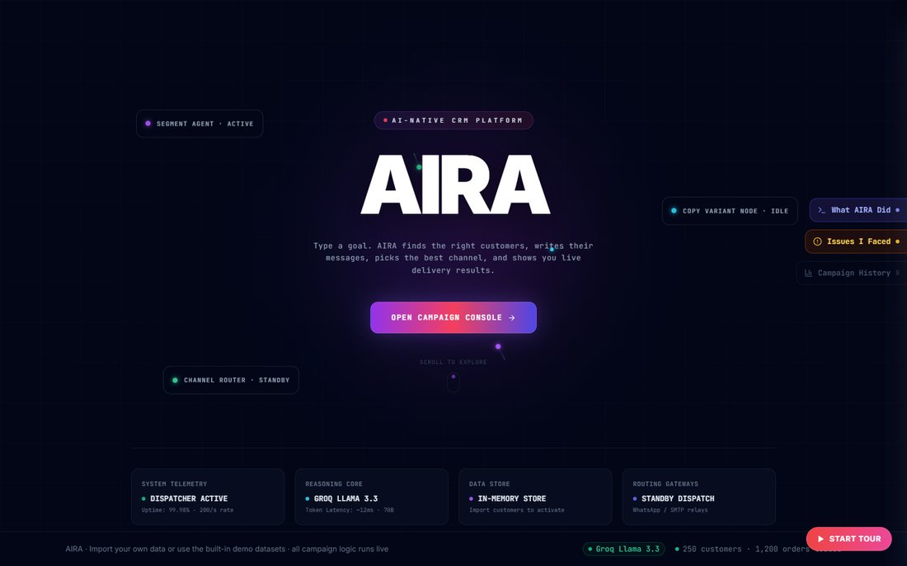

<h1 align="center">Aira K. Salish · Portfolio</h1>

<p align="center"><b>I build AI that's right more often, and prove it with tests.</b></p>

<p align="center">
  <a href="https://aira-salish.vercel.app"></a>
  
  
</p>

<p align="center"><a href="https://aira-salish.vercel.app"></a></p>

## What's on the site

| Section | What it shows |
|---|---|
| **Highlights** | A 30-second skim: #27 of 1,983 at HackerRank, −35% wrong answers in a live AI product, 20M views on one AI short, Citi Bridge top 5% |
| **Experience** | BeSuperhuman.ai (GenAI research), BabyBillion (prompt engineering and automation), ACM-W SRMIST (AI/ML tech lead) |
| **Projects** | Warrant, Drift, AIRA and Log-Seismo, each with a hover preview, a pitch video, a live link and the code |
| **Hackathons** | The HackerRank Orchestrate run (#206 → #27 → #84) with certificates |
| **Certificates** | AWS AI Practitioner, SAP ABAP Cloud, Red Hat RH294, Citi Bridge, GSSoC, HackerRank |
| **Archery** | A small playable target. Six arrows, a little wind |
| **Contact** | Pre-written email, résumé download, save contact, and a summary to forward to a hiring manager |

## Built with

Plain **HTML, CSS and JavaScript**: no framework and no build step. Every push to `main` deploys automatically on **Vercel**.

```bash
python -m http.server 8000   # then open http://localhost:8000
```

## Repo layout

```text
index.html   # the whole site
img/         # photos, project previews, logos
vid/         # hover previews
docs/        # résumé and certificate PDFs
```

📄 **Résumé:** [docs/aira-salish-resume.pdf](docs/aira-salish-resume.pdf) · 🎨 **Design portfolio:** [aira-salish-design.vercel.app](https://aira-salish-design.vercel.app)

---

<sub>Built by **Aira K. Salish** · [GitHub](https://github.com/airasalish) · [Portfolio](https://aira-salish.vercel.app) · [LinkedIn](https://linkedin.com/in/airasalish)</sub>
